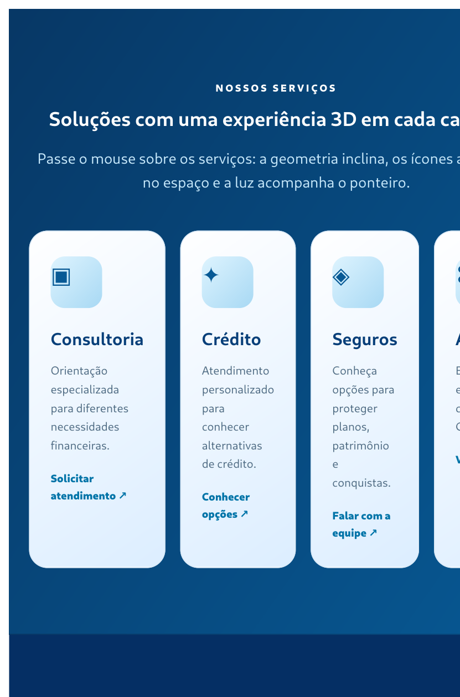

# CONFINTER — Projeto Integrador VI

**Aprimoramento do site CONFINTER: desenvolvimento de um Service Desk integrado à IoT para automação e gestão de chamados**

Projeto desenvolvido no âmbito do **Projeto Integrador VI, segundo semestre de 2026**. Este repositório reúne o código-fonte da aplicação web, as migrações do banco de dados e a documentação técnica da entrega, na versão V7.

## Apresentação

O trabalho dá continuidade ao site institucional da CONFINTER e tem como foco a organização do atendimento técnico. A proposta reúne, em uma mesma aplicação, a abertura de chamados pelo usuário e o registro automático de incidentes a partir de dados enviados por dispositivos de Internet das Coisas (IoT).

O problema abordado é a ligação entre a identificação de uma ocorrência e seu acompanhamento pela equipe responsável. Uma leitura de sensor, por si só, não organiza o atendimento: é necessário definir quando ela representa um incidente, registrar sua origem e acompanhar as providências tomadas. O Service Desk foi desenvolvido para estabelecer essa relação, mantendo o histórico do chamado e o vínculo com a leitura que o originou.

## Objetivos

O objetivo geral é aprimorar o site da CONFINTER por meio de um Service Desk integrado à IoT, destinado à abertura, ao acompanhamento e à gestão de chamados técnicos.

Os objetivos específicos são:

- Disponibilizar um portal para abertura e consulta de chamados por protocolo e código privado.
- Organizar o atendimento por categoria, prioridade, responsável e situação, com registro das alterações.
- Receber dados de sensores ou dispositivos demonstrativos, como o ESP32, por uma API autenticada.
- Aplicar regras às leituras recebidas para gerar incidentes e controlar a repetição de chamados.
- Reunir filtros e indicadores que auxiliem o acompanhamento do atendimento pela equipe técnica.

## Desenvolvimento e delimitação do trabalho

O desenvolvimento foi organizado a partir dos requisitos do relatório parcial, com implementação incremental sobre a aplicação existente. Foram preservados o portal institucional, seus recursos visuais e os módulos administrativos, acrescentando-se os componentes do Service Desk e sua integração com a camada IoT.

O escopo acadêmico corresponde a um **protótipo aplicado ao contexto da CONFINTER**. A entrega contempla o fluxo de atendimento e a estrutura necessária à integração com dispositivos experimentais. A implantação comercial em larga escala e a integração com todos os equipamentos da empresa estão fora desse recorte.

O site também contém módulos de CRM, atendimento presencial e rotinas administrativas. Esses componentes fazem parte da base do sistema; o eixo central deste PI VI é a relação entre telemetria, geração de incidentes e acompanhamento técnico.

## Funcionamento da solução

O atendimento pode começar por duas entradas. Na primeira, o usuário preenche o formulário do portal e recebe um protocolo e um código privado para consultar o chamado. Na segunda, um dispositivo envia uma leitura à API, que a registra e avalia as regras configuradas.

Quando uma leitura atende à condição de uma regra — por exemplo, temperatura acima de um limite definido —, o sistema pode gerar um incidente. O intervalo de controle (*cooldown*) e a verificação de chamado aberto para a mesma regra e dispositivo evitam a criação repetida de chamados. As leituras e os eventos suprimidos permanecem registrados para consulta.

Após a abertura, a equipe técnica utiliza o painel administrativo para atribuir um responsável, alterar a situação do chamado e registrar o atendimento até sua resolução. Nos incidentes originados pela IoT, o chamado mantém a referência ao dispositivo, à leitura e à regra aplicada.

| Componente | Finalidade | Arquivo principal |
|---|---|---|
| Portal de chamados | Abertura e consulta pelo usuário | `service-desk.php` |
| Gestão técnica | Acompanhamento, atribuição e histórico | `admin/service-desk.php` |
| Configuração de regras | Limites e intervalo entre incidentes | `admin/service-desk-regras.php` |
| API IoT | Recebimento autenticado de telemetria | `api/iot_ingest.php` |
| Serviço de atendimento | Regras de negócio do Service Desk | `php/sd_service.php` |
| Serviço IoT | Tratamento e persistência das leituras | `php/iot_service.php` |

## Tecnologias e organização

A aplicação utiliza PHP 8.3+, MySQL/MariaDB, JavaScript, HTML e CSS. A interface existente reúne componentes Bootstrap e Tailwind, além de recursos visuais com Three.js e modelos GLB. O ambiente de implantação proposto utiliza Docker Compose com servidor web e MariaDB.

| Diretório | Conteúdo |
|---|---|
| `admin/` | Painéis de gestão e rotinas administrativas |
| `api/` | Endpoints de integração |
| `php/` | Serviços, conexão, autenticação e autorização |
| `assets/` | Estilos, scripts, imagens e recursos visuais |
| `sql/v7/` | Migrações SQL da versão entregue |
| `scripts/` | Preparação do banco, criação de administrador e manutenção |
| `tests/` | Scripts de teste e diagnóstico |
| `entrega_pi_vi/` | Escopo, arquitetura e roteiros de demonstração e homologação |

## Execução em ambiente local

É necessário ter Docker com Docker Compose disponível. Para execução sem contêineres, consulte os requisitos de PHP, extensões e banco de dados no [roteiro de implantação](entrega_pi_vi/V7_IMPLANTACAO_E_HOMOLOGACAO.md).

1. Copie `.env.example` para `.env`.
2. Configure `DB_NAME`, `DB_USER`, `DB_PASS` e `MYSQL_ROOT_PASSWORD`. Defina valores próprios para `APP_SECRET_KEY` e `IOT_API_KEY`.
3. Na raiz do projeto, inicie o ambiente e aplique as migrações:

```bash
docker compose -f docker-compose.v7.yml up -d --build
docker compose -f docker-compose.v7.yml exec web php scripts/migrate_v7.php --status
docker compose -f docker-compose.v7.yml exec web php scripts/migrate_v7.php
```

4. Crie a conta administrativa; o script solicitará uma senha com pelo menos 14 caracteres:

```bash
docker compose -f docker-compose.v7.yml exec web php scripts/create_admin_v7.php "Administrador" admin admin@seu-dominio.example
```

5. Acesse o portal em `http://localhost:8080` e o formulário de chamados em `http://localhost:8080/service-desk.php`.

Utilize um banco separado para demonstração e testes. O arquivo `.env` contém configurações privadas e não deve ser incluído no controle de versão.

## Demonstração e validação

O [roteiro de demonstração](entrega_pi_vi/GUIA_DEMONSTRACAO_PI_VI.md) organiza a apresentação do fluxo principal: abertura manual, consulta por protocolo, envio de leitura normal e crítica, controle de repetição e resolução do incidente no painel técnico.

A entrega inclui testes unitários e scripts de integração. Os testes unitários da V7 podem ser executados no contêiner:

```bash
docker compose -f docker-compose.v7.yml exec web php tests/test_v7_unit.php
```

Os testes de integração alteram dados e exigem uma base cujo nome termine em `_test`, além de autorização explícita por variável de ambiente. Os procedimentos e critérios estão descritos no [roteiro de implantação e homologação](entrega_pi_vi/V7_IMPLANTACAO_E_HOMOLOGACAO.md).

A homologação foi informada pelo responsável pelo projeto; os registros desses testes não integram este repositório público. A avaliação da integração física com ESP32, da concorrência, do desempenho e da acessibilidade depende dos respectivos registros de execução. O envio de dados por um cliente HTTP permite demonstrar o fluxo da API, mas não comprova o funcionamento de um sensor físico.

## Registros visuais

As imagens a seguir foram preservadas do material de apresentação do projeto e ilustram o portal institucional.





## Documentação da entrega

- [Escopo e critérios de aceite](entrega_pi_vi/ESCOPO_E_CRITERIOS_DE_ACEITE.md)
- [Arquitetura e relacionamentos entre os componentes](entrega_pi_vi/ARQUITETURA.md)
- [Guia de demonstração](entrega_pi_vi/GUIA_DEMONSTRACAO_PI_VI.md)
- [Implantação, testes e homologação da V7](entrega_pi_vi/V7_IMPLANTACAO_E_HOMOLOGACAO.md)
- [Segurança, privacidade e acessibilidade](entrega_pi_vi/SEGURANCA_LGPD_ACESSIBILIDADE.md)
- [Documentação do Service Desk](DOCUMENTACAO_PI_VI_SERVICE_DESK.md)
- [Implementação da camada IoT](IOT_IMPLEMENTACAO.md)

Esta distribuição pública não inclui cadastros reais, credenciais, backups ou documentos acadêmicos privados. Alguns scripts legados de e-mail foram retirados por conter credenciais embutidas; esses fluxos precisam ser revisados antes da implantação a partir deste pacote.
