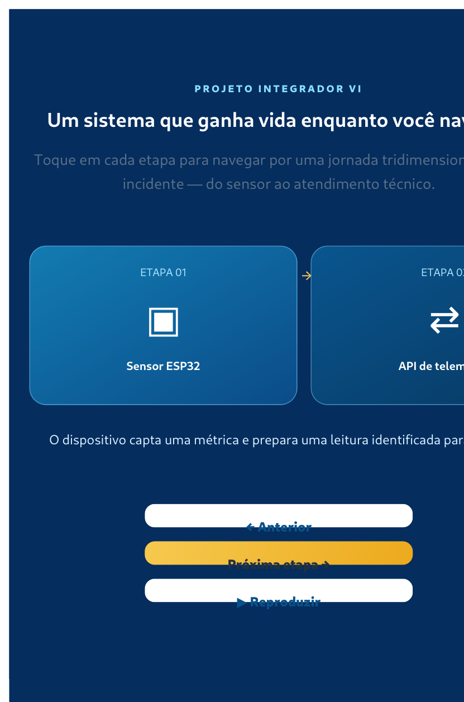

# CONFINTER — Projeto Integrador VI (2026/2)

Projeto acadêmico e aplicação web **CONFINTER**, com portal institucional, central de chamados (Service Desk), integração IoT com ESP32 e painel de gestão.

## Visão do projeto

- Portal institucional responsivo, com assets  e recursos de acessibilidade
- Service Desk com abertura, consulta e acompanhamento de chamados
- Integração de dispositivos IoT com API e regras de abertura de incidentes
- Administração com indicadores, notificações, pesquisa e módulos operacionais
- Migrações SQL versionadas e scripts de implantação

## Imagens do projeto

*Capturas ilustrativas preservadas do material de apresentação existente no pacote. Não constituem, isoladamente, evidência de homologação da V7 em produção.*

## Requisitos e instalação

- PHP 8.3+ e extensões `mysqli`, `mbstring`, `openssl`, `json` e `fileinfo`
- MariaDB/MySQL, servidor HTTP Apache ou Docker Compose
- Copie `.env.example` para `.env` e configure credenciais próprias, nunca registradas no Git
- Ambiente Docker: `docker compose -f docker-compose.v7.yml up -d --build`
- Migrações: `php scripts/migrate_v7.php --status` e `php scripts/migrate_v7.php`
- Testes unitários: `php tests/test_v7_unit.php`

Consulte `entrega_pi_vi/V7_IMPLANTACAO_E_HOMOLOGACAO.md` para instruções adicionais. Não execute scripts destrutivos ou de teste contra a base de produção.

## Publicação responsável

Este repositório contém código e assets, **sem** banco de clientes, credenciais reais, documentos acadêmicos privados, backups ou históricos internos de desenvolvimento. Não faça commit de `.env`, logs, cadastros reais ou prints de painéis com dados pessoais. Scripts legados com credenciais embutidas foram excluídos do pacote público; confirme os fluxos de e-mail antes de implantá-lo a partir desta distribuição.

