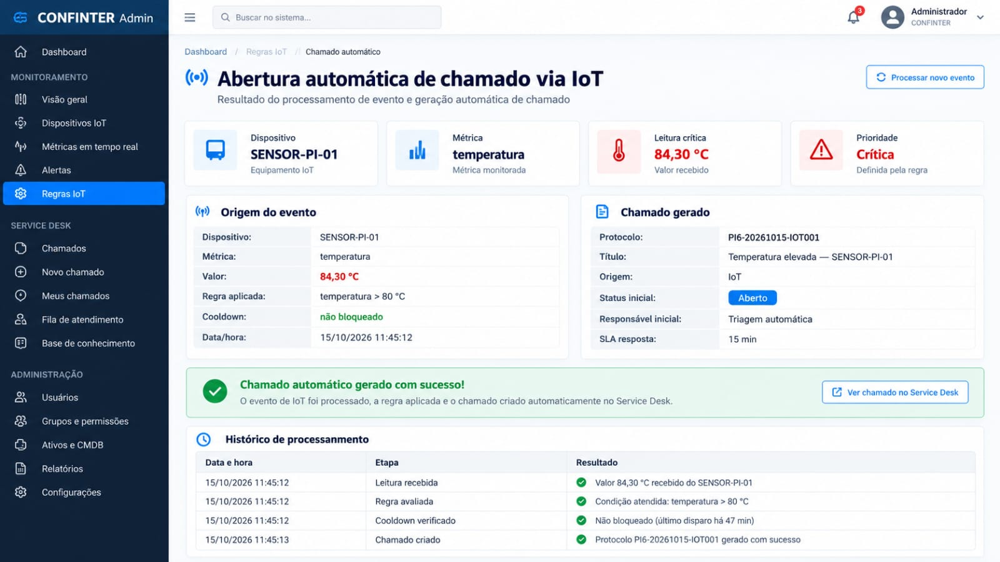
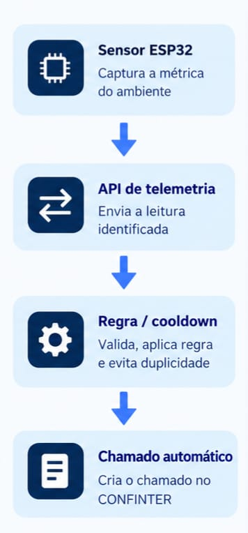
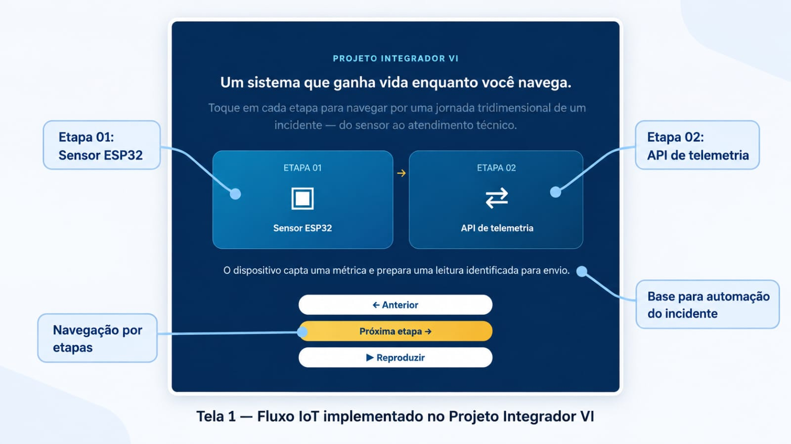
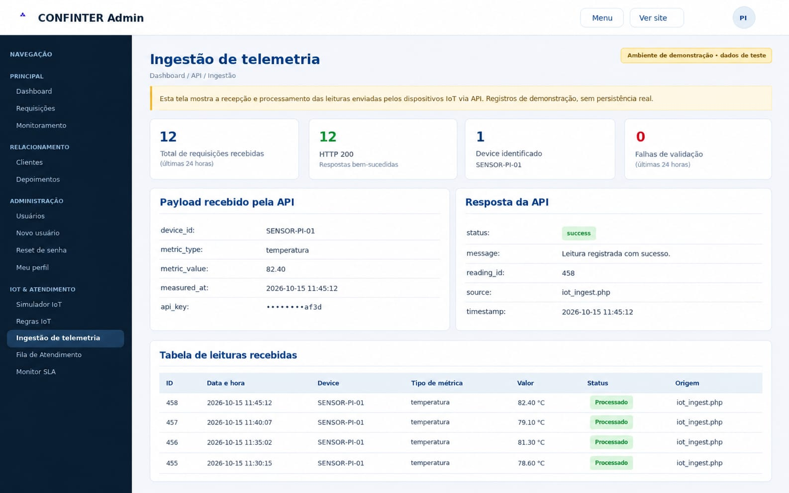
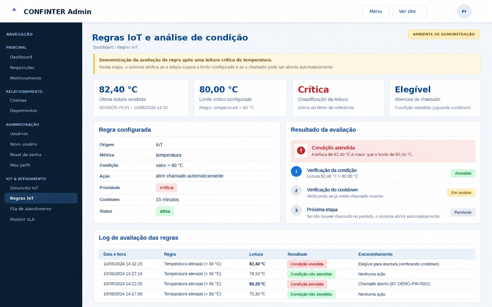
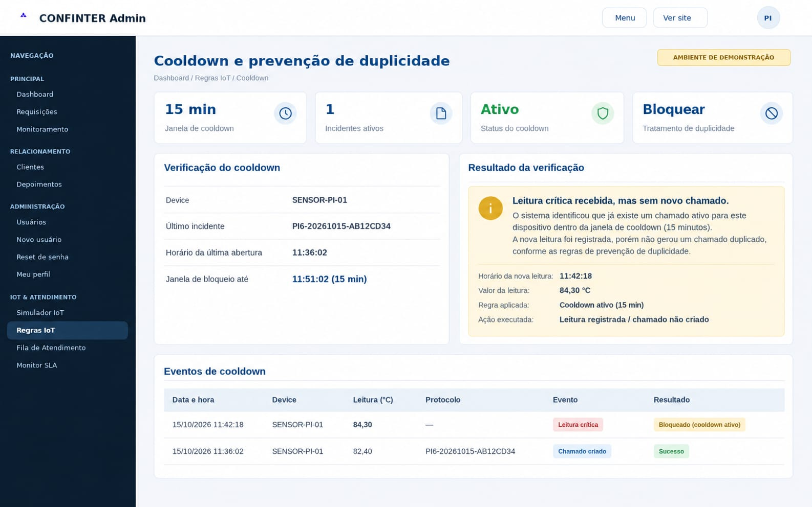
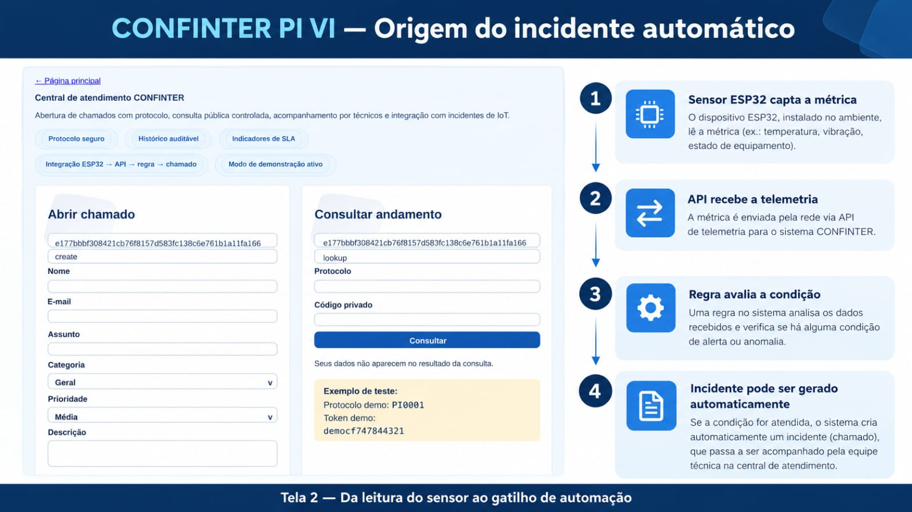
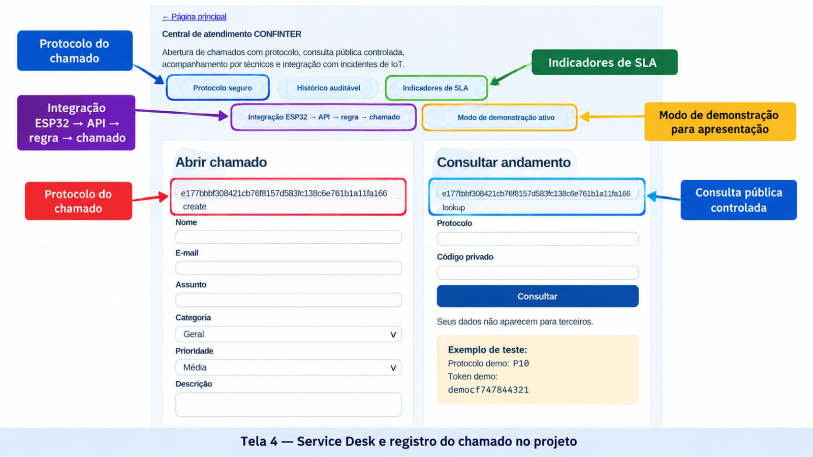
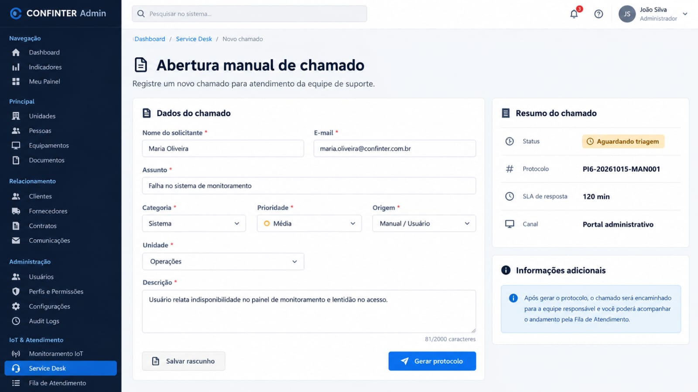
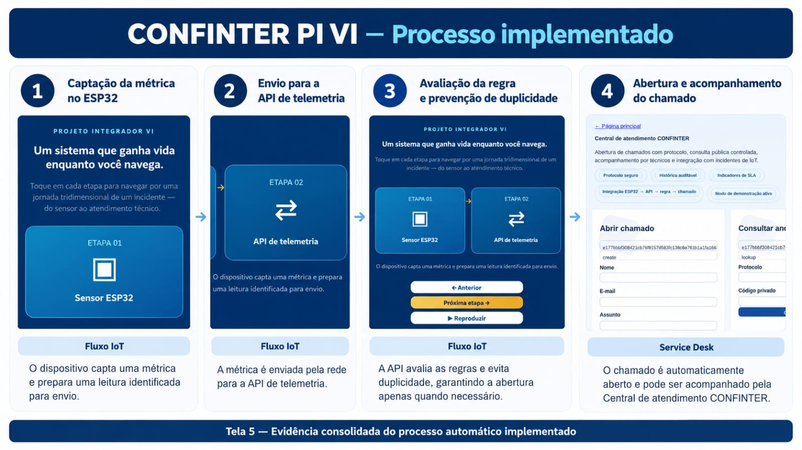

# CONFINTER — Projeto Integrador VI

**Aprimoramento do site CONFINTER: desenvolvimento de um Service Desk integrado à IoT para automação e gestão de chamados**

Projeto desenvolvido no âmbito do **Projeto Integrador VI, segundo semestre de 2026**. Este repositório reúne o código-fonte da aplicação web, as migrações do banco de dados e a documentação técnica da entrega, na versão V7.

## Apresentação

O trabalho dá continuidade ao site institucional da CONFINTER e tem como foco a organização do atendimento técnico. A proposta reúne, em uma mesma aplicação, a abertura de chamados pelo usuário e o registro automático de incidentes a partir de dados enviados por dispositivos de Internet das Coisas (IoT).

O problema abordado é a ligação entre a identificação de uma ocorrência e seu acompanhamento pela equipe responsável. Uma leitura de sensor, por si só, não organiza o atendimento: é necessário definir quando ela representa um incidente, registrar sua origem e acompanhar as providências tomadas. O Service Desk foi desenvolvido para estabelecer essa relação, mantendo o histórico do chamado e o vínculo com a leitura que o originou.

**A principal contribuição do PI VI é transformar uma leitura crítica de IoT em um chamado técnico automático.** O fluxo implementado recebe a telemetria, aplica a regra configurada, verifica a existência de um incidente e o intervalo de bloqueio e, quando cabível, cria o chamado no Service Desk. Assim, o registro da ocorrência deixa de depender exclusivamente do preenchimento manual por um usuário.

## Objetivos

O objetivo geral é aprimorar o site da CONFINTER por meio de um Service Desk integrado à IoT, destinado à abertura, ao acompanhamento e à gestão de chamados técnicos.

Os objetivos específicos são:

- Disponibilizar um portal para abertura e consulta de chamados por protocolo e código privado.
- Organizar o atendimento por categoria, prioridade, responsável e situação, com registro das alterações.
- Receber dados de sensores ou dispositivos demonstrativos, como o ESP32, por uma API autenticada.
- Aplicar regras às leituras recebidas para gerar incidentes e controlar a repetição de chamados.
- Reunir filtros e indicadores que auxiliem o acompanhamento do atendimento pela equipe técnica.

## Desenvolvimento e delimitação do trabalho

O desenvolvimento foi organizado a partir dos requisitos do relatório parcial, com implementação incremental sobre a aplicação existente. Foram preservados o portal institucional, seus recursos visuais e os módulos administrativos, acrescentando-se os componentes do Service Desk e sua integração com a camada IoT.

O escopo acadêmico corresponde a um **protótipo aplicado ao contexto da CONFINTER**. A entrega contempla o fluxo de atendimento e a estrutura necessária à integração com dispositivos experimentais. A implantação comercial em larga escala e a integração com todos os equipamentos da empresa estão fora desse recorte.

O site também contém módulos de CRM, atendimento presencial e rotinas administrativas. Esses componentes fazem parte da base do sistema; o eixo central deste PI VI é a relação entre telemetria, geração de incidentes e acompanhamento técnico.

## Funcionamento da solução

O atendimento pode começar por duas entradas. Na primeira, o usuário preenche o formulário do portal e recebe um protocolo e um código privado para consultar o chamado. Na segunda, um dispositivo envia uma leitura à API, que a registra e avalia as regras configuradas.

Quando uma leitura atende à condição de uma regra — por exemplo, temperatura acima de um limite definido —, o sistema pode gerar um incidente. O intervalo de controle (*cooldown*) e a verificação de chamado aberto para a mesma regra e dispositivo evitam a criação repetida de chamados. As leituras e os eventos suprimidos permanecem registrados para consulta.

Após a abertura, a equipe técnica utiliza o painel administrativo para atribuir um responsável, alterar a situação do chamado e registrar o atendimento até sua resolução. Nos incidentes originados pela IoT, o chamado mantém a referência ao dispositivo, à leitura e à regra aplicada.

| Componente | Finalidade | Arquivo principal |
|---|---|---|
| Portal de chamados | Abertura e consulta pelo usuário | `service-desk.php` |
| Gestão técnica | Acompanhamento, atribuição e histórico | `admin/service-desk.php` |
| Configuração de regras | Limites e intervalo entre incidentes | `admin/service-desk-regras.php` |
| API IoT | Recebimento autenticado de telemetria | `api/iot_ingest.php` |
| Serviço de atendimento | Regras de negócio do Service Desk | `php/sd_service.php` |
| Serviço IoT | Tratamento e persistência das leituras | `php/iot_service.php` |

## Como implementamos a abertura automática por IoT

A integração foi construída em PHP e MySQL/MariaDB, aproveitando a camada de dispositivos e telemetria do sistema e acrescentando as regras de geração de chamados ao Service Desk. O processamento ocorre na requisição recebida pela API, na seguinte sequência:

1. **Identificação e envio da leitura.** O dispositivo, como um ESP32 conectado a um sensor, envia uma requisição `POST` para `api/iot_ingest.php`, com identificação, métrica, valor e unidade. A API exige a chave configurada em `IOT_API_KEY`, enviada pelo cabeçalho `X-IoT-Key`.
2. **Validação e registro.** A função `ingestIotPayload()`, em `php/iot_service.php`, valida os campos, atualiza o cadastro e a última comunicação do dispositivo em `iot_devices` e registra a leitura em `iot_telemetry`.
3. **Avaliação da condição.** A função `sdEvalIotRules()`, em `php/sd_service.php`, consulta as regras ativas de `sd_iot_rules` compatíveis com a métrica e o dispositivo. Os operadores permitem comparar valores maiores, maiores ou iguais, menores ou menores ou iguais ao limite configurado.
4. **Controle de repetição.** Antes de abrir o incidente, o sistema verifica se há chamado ainda não resolvido ou fechado para a mesma regra e dispositivo, ou se a última abertura está dentro do cooldown. O código utiliza um bloqueio nomeado do MySQL (`GET_LOCK`) e uma transação para coordenar esse trecho do processamento.
5. **Criação e rastreabilidade.** Quando a condição é atendida e não há bloqueio, `sdCreate()` cria o chamado com origem `iot`, categoria IoT e prioridade definida pela regra. O registro mantém `device_id`, `telemetry_id` e `rule_id`, permitindo relacionar o atendimento à leitura original. Os eventos são registrados em `sd_iot_rule_events` como `created` ou `suppressed`.
6. **Atendimento pela equipe.** O incidente passa a integrar o Service Desk, no qual a equipe pode atribuir um responsável, registrar notas e acompanhar as mudanças de situação até a resolução, com histórico em `sd_ticket_history`.

No exemplo das imagens, a regra utiliza **temperatura acima de 80 °C** e **cooldown de 15 minutos**. Uma leitura crítica pode gerar o chamado; outra leitura na janela de bloqueio é registrada sem abrir um atendimento duplicado. Esses valores pertencem ao cenário demonstrativo e devem ser definidos conforme o equipamento e o ambiente monitorado.

O contrato atual de envio utiliza os campos abaixo. Algumas telas da apresentação usam rótulos diferentes, como `metric_type` e `metric_value`; para integrar um dispositivo à versão deste repositório, utilize `metric` e `value`:

```json
{
  "device_id": "SENSOR-PI-01",
  "device_name": "Sensor de demonstracao",
  "metric": "temperatura",
  "value": 84.3,
  "unit": "C"
}
```

O registro da telemetria precede a avaliação das regras. A resposta da API inclui a leitura registrada e os resultados da avaliação em `incidents`. O envio pelo ESP32 requer a configuração do sensor, da rede e da chave no dispositivo; a implementação do servidor está concentrada nos arquivos indicados acima.

## Contribuição para a CONFINTER

Para a CONFINTER, a integração aproxima o monitoramento do trabalho da equipe de suporte. Em vez de manter o alerta isolado em uma tela, o sistema o transforma em uma ocorrência com identificação, prioridade e histórico de atendimento.

| Necessidade operacional | Contribuição da implementação |
|---|---|
| Registrar uma condição crítica identificada pelo monitoramento | Abertura do chamado pela regra, sem exigir que alguém repita os dados em um formulário |
| Evitar vários atendimentos para uma ocorrência persistente | Verificação de chamado ativo e cooldown, preservando as novas leituras |
| Entender a origem de um incidente | Vínculo entre dispositivo, leitura, regra e chamado |
| Organizar o trabalho do suporte | Acompanhamento de prioridade, responsável, situação e histórico na central |
| Avaliar o atendimento | Registros de abertura, primeira resposta e resolução para consulta e indicadores |

Esses recursos buscam reduzir o intervalo entre a detecção e o registro do problema, diminuir o retrabalho e facilitar o acompanhamento de equipamentos ou condições ambientais relevantes à operação. A quantificação desses ganhos depende de medições em uso; não são apresentados percentuais de redução de tempo ou custo nesta entrega.

## Tecnologias e organização

A aplicação utiliza PHP 8.3+, MySQL/MariaDB, JavaScript, HTML e CSS. A interface existente reúne componentes Bootstrap e Tailwind, além de recursos visuais com Three.js e modelos GLB. O ambiente de implantação proposto utiliza Docker Compose com servidor web e MariaDB.

| Diretório | Conteúdo |
|---|---|
| `admin/` | Painéis de gestão e rotinas administrativas |
| `api/` | Endpoints de integração |
| `php/` | Serviços, conexão, autenticação e autorização |
| `assets/` | Estilos, scripts, imagens e recursos visuais |
| `sql/v7/` | Migrações SQL da versão entregue |
| `scripts/` | Preparação do banco, criação de administrador e manutenção |
| `tests/` | Scripts de teste e diagnóstico |
| `entrega_pi_vi/` | Escopo, arquitetura e roteiros de demonstração e homologação |

## Execução em ambiente local

É necessário ter Docker com Docker Compose disponível. Para execução sem contêineres, consulte os requisitos de PHP, extensões e banco de dados no [roteiro de implantação](entrega_pi_vi/V7_IMPLANTACAO_E_HOMOLOGACAO.md).

1. Copie `.env.example` para `.env`.
2. Configure `DB_NAME`, `DB_USER`, `DB_PASS` e `MYSQL_ROOT_PASSWORD`. Defina valores próprios para `APP_SECRET_KEY` e `IOT_API_KEY`.
3. Na raiz do projeto, inicie o ambiente e aplique as migrações:

```bash
docker compose -f docker-compose.v7.yml up -d --build
docker compose -f docker-compose.v7.yml exec web php scripts/migrate_v7.php --status
docker compose -f docker-compose.v7.yml exec web php scripts/migrate_v7.php
```

4. Crie a conta administrativa; o script solicitará uma senha com pelo menos 14 caracteres:

```bash
docker compose -f docker-compose.v7.yml exec web php scripts/create_admin_v7.php "Administrador" admin admin@seu-dominio.example
```

5. Acesse o portal em `http://localhost:8080` e o formulário de chamados em `http://localhost:8080/service-desk.php`.

Utilize um banco separado para demonstração e testes. O arquivo `.env` contém configurações privadas e não deve ser incluído no controle de versão.

## Demonstração e validação

O [roteiro de demonstração](entrega_pi_vi/GUIA_DEMONSTRACAO_PI_VI.md) organiza a apresentação do fluxo principal: abertura manual, consulta por protocolo, envio de leitura normal e crítica, controle de repetição e resolução do incidente no painel técnico.

A entrega inclui testes unitários e scripts de integração. Os testes unitários da V7 podem ser executados no contêiner:

```bash
docker compose -f docker-compose.v7.yml exec web php tests/test_v7_unit.php
```

Os testes de integração alteram dados e exigem uma base cujo nome termine em `_test`, além de autorização explícita por variável de ambiente. Os procedimentos e critérios estão descritos no [roteiro de implantação e homologação](entrega_pi_vi/V7_IMPLANTACAO_E_HOMOLOGACAO.md).

A homologação foi informada pelo responsável pelo projeto. As imagens fornecidas para esta entrega estão organizadas a seguir como registros de apresentação, incluindo telas identificadas como ambiente de demonstração. A avaliação da integração física com ESP32, da concorrência, do desempenho e da acessibilidade depende dos respectivos registros de execução. O envio de dados por um cliente HTTP permite demonstrar o fluxo da API, mas não comprova o funcionamento de um sensor físico.

## Registros visuais do Service Desk e da integração IoT

As dez imagens selecionadas pelo responsável apresentam o processo de automação e os recursos de atendimento do PI VI. A sequência começa pelo resultado principal, detalha as etapas e termina com uma visão consolidada. As capturas e os diagramas foram preservados integralmente; as marcações de demonstração e os dados de exemplo fazem parte do material original.

### Figura 1 — Abertura automática do chamado



O material apresenta a leitura de 84,30 °C do dispositivo `SENSOR-PI-01`, a regra aplicada e o chamado gerado com origem IoT. A tela reúne o evento, o protocolo e as etapas de processamento, tornando visível a relação entre o monitoramento e o atendimento.

### Figura 2 — Fluxo de integração



Síntese da arquitetura: o ESP32 captura a métrica; a API recebe a leitura identificada; o motor avalia a regra e a repetição; o Service Desk recebe o chamado quando as condições são atendidas.

### Figura 3 — Apresentação das etapas no portal



A interface por etapas explica o percurso da informação para a apresentação acadêmica. Ela representa o fluxo da solução; a navegação entre etapas não corresponde, por si só, à execução de uma leitura física.

### Figura 4 — Recebimento da telemetria



A tela organiza os dados de entrada e a resposta esperada do processamento. O próprio registro informa que utiliza dados de teste sem persistência real. No backend, a persistência é realizada por `ingestIotPayload()` quando o banco está configurado.

### Figura 5 — Avaliação da regra



O cenário demonstra a comparação entre a leitura de 82,40 °C e o limite de 80 °C. Atender à condição torna o evento elegível; a criação do chamado ainda depende da verificação de duplicidade e do cooldown.

### Figura 6 — Cooldown e prevenção de duplicidade



Uma nova leitura crítica é mantida no registro, mas não gera outro chamado na janela de bloqueio. Esse tratamento evita sobrecarregar a fila com a repetição de uma ocorrência já identificada. No código atual, a existência de chamado ativo também impede nova abertura para a mesma regra e dispositivo, mesmo após o término do intervalo.

### Figura 7 — Origem do incidente automático



O diagrama relaciona a central de atendimento às quatro etapas de origem do incidente. A automação cria o registro para acompanhamento; o diagnóstico e a resolução permanecem sob responsabilidade da equipe técnica.

### Figura 8 — Registro e consulta no Service Desk



A central reúne abertura e consulta de andamento. Os valores exibidos como exemplos de teste pertencem à demonstração. Na implementação atual, o protocolo identifica o chamado e o código privado autoriza a consulta; o campo técnico destacado acima dos formulários é o token CSRF, não o protocolo do atendimento.

### Figura 9 — Abertura manual complementar



O registro manual complementa a automação: problemas percebidos por usuários também podem chegar ao suporte. A imagem apresenta esse caminho de atendimento, enquanto o diferencial da integração IoT é iniciar o chamado a partir da avaliação de uma leitura.

### Figura 10 — Processo consolidado



O painel reúne o percurso completo utilizado na apresentação do PI VI, da captação da métrica ao acompanhamento do chamado. A [relação dos arquivos originais](docs/screenshots/pi-vi-iot/README.md) identifica a origem de cada imagem.

## Documentação da entrega

- [Escopo e critérios de aceite](entrega_pi_vi/ESCOPO_E_CRITERIOS_DE_ACEITE.md)
- [Arquitetura e relacionamentos entre os componentes](entrega_pi_vi/ARQUITETURA.md)
- [Guia de demonstração](entrega_pi_vi/GUIA_DEMONSTRACAO_PI_VI.md)
- [Implantação, testes e homologação da V7](entrega_pi_vi/V7_IMPLANTACAO_E_HOMOLOGACAO.md)
- [Segurança, privacidade e acessibilidade](entrega_pi_vi/SEGURANCA_LGPD_ACESSIBILIDADE.md)
- [Documentação do Service Desk](DOCUMENTACAO_PI_VI_SERVICE_DESK.md)
- [Implementação da camada IoT](IOT_IMPLEMENTACAO.md)

Esta distribuição pública não inclui cadastros reais, credenciais, backups ou documentos acadêmicos privados. Alguns scripts legados de e-mail foram retirados por conter credenciais embutidas; esses fluxos precisam ser revisados antes da implantação a partir deste pacote.
