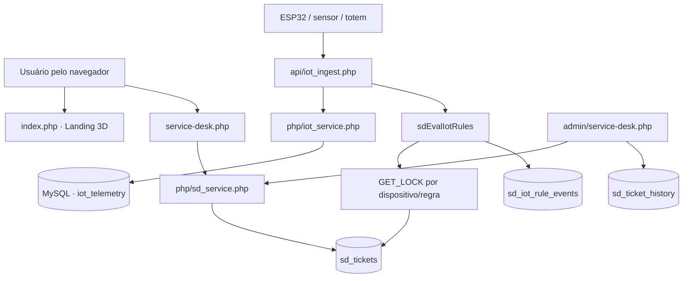

# Arquitetura da solução

## Entidades e relacionamentos
- `sd_tickets` identifica protocolo e token de consulta por hash; para tickets IoT relaciona `device_id`, `telemetry_id` e `rule_id`.
- `sd_ticket_history` registra transições e ator.
- `sd_iot_rules` mantém métrica, operador, limite e cooldown.
- `sd_iot_rule_events` guarda tanto incidentes criados quanto eventos suprimidos, vinculando leitura ao ticket existente quando aplicável.
- `iot_devices` e `iot_telemetry` já fazem parte da camada IoT; são necessárias no ambiente de homologação.

## Cuidados arquiteturais
A API exige `X-IoT-Key`. O processamento é síncrono; para alto volume seriam necessários mensageria, retries idempotentes e integração observável. O SLAs calculados são em **minutos corridos** e não usam horário comercial/feriados. WebGL/CSS3 devem permitir redução de movimento. Nenhum diagrama substitui o teste real.
